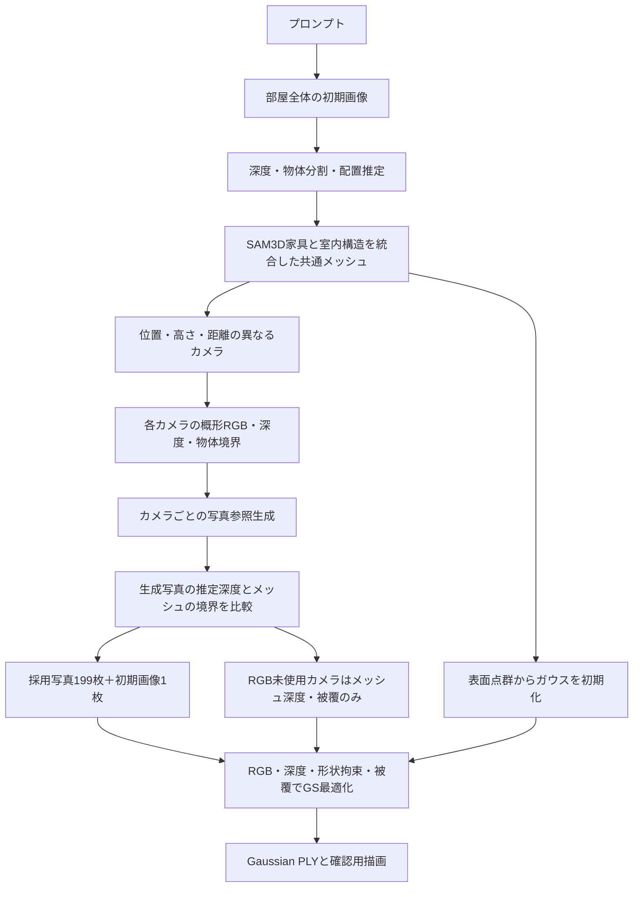

# 現行の生成フローと既定233カメラ（2026-11-06）

## 既定の規模
以後の通常のgenerate --mode room-localは追加233カメラを全て評価する。初期画像のカメラは別なので学習用のカメラ設定は計234。RGB教師の目標は初期画像1＋生成写真199＝200枚。全233カメラを評価した後も合格写真が199枚未満ならrgb_target_unmetとし、カメラを無断で増やしたり不合格画像を色の教師へ混ぜたりしない。合格が多い場合は生成順で先に合格した199枚をRGBに選び、残りのカメラは形状のみ使用する。

台数と配置方針を固定するもので、異なる部屋に同じ座標を流用するものではない。部屋寸法・家具位置に応じて安全な位置を再計算する。以前の200枚実験は319候補のうち233カメラを評価して200枚に到達した。今後の既定は候補上限も233に固定するため、RGB採用数が不足する可能性はある。

```bash
cd '/home/dpc7/world GS'
./run.sh generate --prompt 'A cozy living room with a sofa, two bookshelves and a wooden table' --output runs/room233_new --seed 106
./run.sh reference-export runs/room233_new --output runs/room233_new_production --train-steps 24000 --max-points 180000
# 既存の概形から明示指定で写真参照を作る場合
./run.sh reference-run runs/existing_proxy --output runs/room233_refs --camera-count 233 --rgb-target 200
```

過去実験のカメラ数を保つため、低水準reference-runの引数省略は従来の意味を維持する。新しい通常のprompt-first生成の既定が233である。既存の異なる要求を持つ出力先への上書きはしない。

## 今回実行した流れ



1. ローカルFLUX.2 Klein Baseで部屋全体の初期写真を生成。200枚実験では既に生成したseed 105の初期画像を維持した。
2. 画像の深度・物体領域・室内配置を推定。家具の切り出しからSAM3Dで形状を復元し、床・壁・天井・窓・ラグと統合。初期深度は補助に使うが、GSに与える基準深度は最終的な共通メッシュから描画する。
3. WorldMesh型の対向・壁沿い・高所カメラに、多高さ・多距離の視点を加える。生成済みの合格画像のうち向きが近いものを外観参照に使う。
4. 各カメラの概形RGB・メッシュ深度・物体境界を条件に、SD1.5 inpainting + depth/canny ControlNet + IP-Adapterで写真を生成。DepthProで推定した深度境界と概形を比較。薄物や窓の判定の弱点は残る。
5. 今回の200枚版では既存の生成写真21枚を採用し、新たに178枚を採用した。初期1枚を加えてRGB教師200枚。評価カメラ233中、不合格34視点は写真RGBを使わず形状のみ参照した。『今回の新規生成0枚』ではない。
6. 共通メッシュ上に初期ガウスを配置し、RGB画像損失・メッシュ深度損失・形状拘束・被覆損失で24,000ステップ最適化。位置・尺度・回転・不透明度・SH色係数を学習。185,332ガウスのbinary little-endian PLYを出力した。

## 添付の模式図との対応・相違
(a) 初期画像から概形を作り多視点画像を得る大枠は共通。ただし現実装は物体のSAM3Dメッシュを用いる。画像生成の主条件は概形RGB・深度・物体境界で、法線を独立した画像条件として入力してはいない。
(b) メッシュ表面点からガウスを初期化する段階は対応する。
(c) 現実装はRGB採否0/1、メッシュの有効マスク、深度損失の構造/家具別重みを使う。図のような細粒度の意味領域・観測信頼度に基づくRGB観測重みをそのまま実装したわけではない。
(d) 大きな相違点。現実装はRGBのみの最適化ではなく、形状・不透明度も学習する。図を現実装の説明に使う場合は『RGB・形状・不透明度の同時最適化（メッシュ深度による拘束）』とし、『幾何と不透明度を固定』を外す。RGBのみ固定形状の式を現実装の目的関数として記載しない。
(e) 学習したガウスを描画・PLYへ出力する段階は対応する。

今回の変更は以後のカメラ既定値と選択制御。既存200枚の画像・メッシュ・PLYは再生成も変更もしていない。
