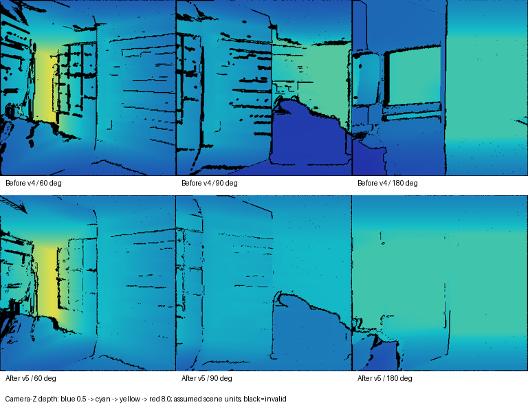
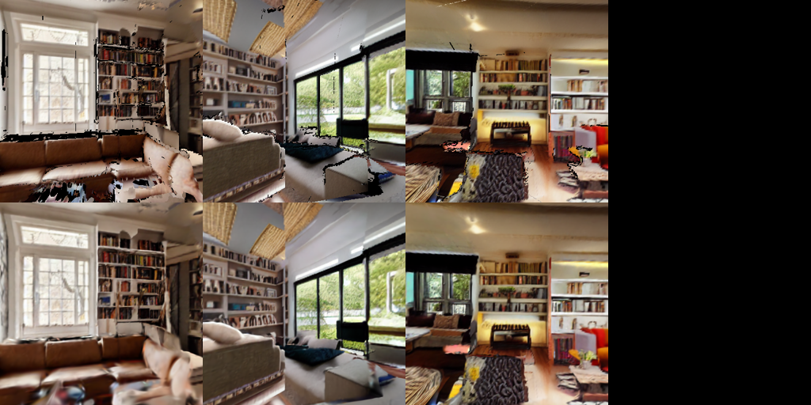

# 深度推定と視点境界の修正

## 原因

v4のDepth Anything V2出力は画像ごとに正規化された相対逆深度から作られる。視点間を深度の倍率だけで合わせていたため、逆深度のオフセット差が残っていた。既観測領域と未知領域の境界で深度を突然切り替え、さらに全頂点が未知領域に入る三角形だけを追加していたため、接続の段差と格子間の隙間が生じ得た。個別の深度インパルスや、簡易家具の深度を上限にした切り詰めも形状に影響していた。

## 変更

- `1 / reference_depth = a / predicted_depth + b` をIRLSで頑健に推定。既知領域の一部を校正から除外して倍率だけの方式と比較し、改善する場合に採用。逆深度の符号や外挿の不安定さも検査する。
- 色が似た局所領域の孤立した深度スパイクを中央値で補正。無効値は校正・形状追加から除外。
- 境界の未知側20画素以内に、色と深度の不連続をまたがないlog深度の補正を解く。既観測深度は固定し、遠方への補正は減衰させる。
- 色と奥行きが近い場合だけ、未知側5画素以内を色補間。物体の輪郭のような大きな色・深度差をぼかさない。
- 重なりを含む接続三角形を追加し、グリッド間の隙間を減らす。深度不連続をまたぐ三角形や以前の観測と矛盾する形状は引き続き除外する。
- 深度の上限は家具の箱ではなく、部屋の囲いから取得。接続補正後も囲いを越える未知点を制限する。

## 既存データの修正

```bash
cd '/home/dpc7/world GS'
./run.sh refine-depth runs/livingroom_expand_v4_final --output runs/livingroom_depth_fixed_new
./run.sh train runs/livingroom_depth_fixed_new --steps 2000 --max-points 60000
```

元データは保持し、空の出力先が必要。v4/v5のexpandモードの完了したキーフレームに対応する。通常の `generate --mode expand` にも同じ深度補正を適用する。過去の画像を使う修正では、新規の画像補完は行わない。既観測領域の再投影と狭い範囲の境界補間は行う。

## 検証

33件の自動テストが成功。既知の逆深度オフセット・外れ値を与えた場合の未観測領域での復元、孤立点の除去、物体の奥行き段差の保持、境界残差の減衰、接続三角形、囲いの制限、および既存処理を検証した。

`depth_diagnostics.json` には校正用アンカー数、校正から除外した画素での対数深度誤差、補正前後の境界段差を記録する。境界段差は色が近い境界隣接画素間の `abs(log(d1/d2))` の中央値。既存の共有形状に対する整合性の指標であり、実物への正確さを示さない。

## 限界

単眼深度には尺度の不定性があり、元画像にある歪み・不整合や誤った物体の前後関係をすべて解決するものではない。カメラ画角は引き続き75度の仮定。強い物体境界は意図的に平滑化せず、遮蔽や未観測部分には穴が残り得る。元の共有形状自体が誤っていれば、その誤差を整合させてしまう場合もある。

## このPCでの実行結果

入力は `runs/livingroom_expand_v4_final`、修正先は `/home/dpc7/world GS/runs/livingroom_depth_seams_v5_final`。既存キーフレーム20枚を利用して深度を再推定した。画像の新規生成は行っていない。

|項目|実測|
|---|---:|
|学習／評価視点|29／3|
|初期点群|421,317|
|更新形状の三角形|726,232|
|逆深度の倍率・オフセット補正を採用した視点|14|
|補正した孤立深度点|135|
|校正除外画素の対数誤差中央値：倍率のみ／採用方式|0.2013／0.1114|
|境界段差指標：境界補正前／後|0.1207／0.0111|
|学習ステップ／終了Gaussian数|2,000／180,000|
|SH次数|3|

校正の比較は同じ修復過程の共有形状に対する倍率のみの校正と採用校正の比較。境界の比較も同じ修復過程で境界補正を入れる前後であり、v4完成品とv5完成品の実物に対する精度差ではない。生成形状とGSの一致評価も、参照形状が変わるため旧版の数値との単純比較はできない。

共通のカメラ深度スケールで表示したv4とv5の深度。上段がv4、下段がv5。黒は無効領域。深度は仮定したシーン単位であり、実測メートルではない。



上段は修正した生成形状、下段は学習したGS。大きな家具の形や床の歪み、未観測部分の穴はなお残っている。



[検証結果](v5/verification.json)、[視点別の深度校正記録](v5/depth-diagnostics.json)
