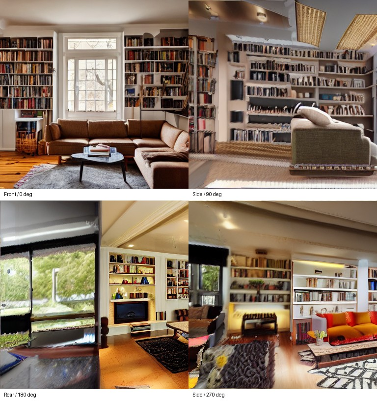
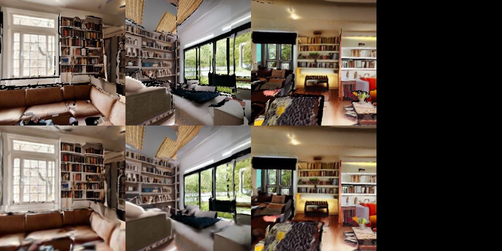

# 全周補完と初期ガイドからの形状更新

## 目的と変更範囲

v3は正面で検出した家具の手続き的メッシュを描画してGSへ学習させていたため、背面の内容が増えず、簡易メッシュの形と材質を引き継いでいた。v4は次の2点を変更する。

1. 初期の正面画像を保持し、水平12方向以上と上下8方向を順に補完。既生成領域は共有RGB-D形状から再投影して固定し、未観測領域だけをControlNet Depth付きinpaintingで生成する。
2. 初期メッシュは弱い制御（ControlNet強度0.35）とスケール・部屋境界の事前分布としてのみ使用。生成画像からDepth Anything V2で新しい深度を推定し、観測済み領域との重なりで尺度を合わせ、未知領域の形状を追加する。GS教師には補完画像と推定深度、更新後形状の移動視点を使う。

水平補完では最大50cm程度のカメラ移動も導入する。追加参照では半径50cmの移動を使う。画像の未知部分を生成するため、正面家具の単なる別角度描画とは異なる。一方、これは大きな移動に対する品質を保証しない。

## 整合性

- 既観測RGB・深度は補完で変更せず、世界座標の共有形状で受け渡す。
- 深度不連続をまたぐ三角形、極端な斜視面を除外する。
- 以前の視点で空いていたと観測された空間に、後から手前の形状を置く矛盾を検査する。
- 更新形状への再投影と深度が合わない生成ピクセルは学習マスクから除外する。
- GSのメッシュ位置拘束係数は0。推定深度の損失係数を0.1→0.02へ減らし、位置・回転・スケール・不透明度・SHを最適化する。

共有再投影は独立画像生成より整合を保つ仕組みだが、全周の意味的一貫性を保証するものではない。単眼深度は相対尺度であり、誤差や継ぎ目が累積する。360度を一度に生成するモデルや物体単位の完全な3D生成モデルは未導入。

## 実行

```bash
cd '/home/dpc7/world GS'
./run.sh generate --prompt 'A cozy living room with a sofa, bookshelves and a wooden table, wide angle interior photograph' --front-image runs/livingroom/front.png --output runs/livingroom_expand_new --mode expand --size 384 --views 12 --seed 42
./run.sh train runs/livingroom_expand_new --steps 2000 --max-points 60000
```

`--front-image` は比較時だけの任意指定。通常は省略してプロンプトから生成する。既存出力先への上書きは拒否する。`--size` は通常256以上、demoだけ64から実行可能。

## 検証と限界

自動テスト25件：未知領域の深度がガイドと異なる形へ更新されること、既観測深度の保持、未観測三角形のみの追加、手前の色・深度の遮蔽、水平全周と上下のカメラ移動、過去の視点を塞ぐ新規形状の排除、上下の説明文とカメラ向きの一致、および既存テスト。

`--demo` は処理検証用で、画像生成品質を証明しない。`heldout_preview.png` の上段は生成RGB-D形状の描画、下段はGS。評価値はこの生成形状との一致度であり、実物や独立した実写との精度ではない。出力が写実的であることや物体配置が全周で正しいことを、この評価値だけで判断しない。

本変更はUnityでの動的な光源変更に対応するものではない。照明・材質の分離学習と対応レンダラーは別の開発項目。

## 2026-10-16の実行結果

保存先：`/home/dpc7/world GS/runs/livingroom_expand_v4_final`。既存の正面画像を再利用し、水平の補完結果は途中の検証出力から再利用、上下8方向は向きの説明を修正して再生成した。履歴は `validation_provenance.json` に保存。

|項目|実測|
|---|---:|
|補完キーフレーム（正面を含む）|20|
|学習視点数（追加移動視点を含む）|29|
|評価視点数|3|
|初期点群|352,686|
|更新形状の三角形|714,477|
|追加三角形|643,679|
|学習|2,000ステップ・60,000点開始・180,000点終了|
|SH次数|3|
|メッシュ位置拘束係数|0|
|移動カメラ間の最大距離|1.0（仮定したシーン単位）|

出力PLYの62属性・レコード数・有限値を検証。評価用の生成形状に対するRGB L1は0.0172〜0.0324、相対深度誤差は約1.15〜2.69%。参照自体の正しさを示す数値ではない。

正面・90°・180°・270°の参照画像。追加方向に窓、棚、家具等が生成されているが、重複や継ぎ目の歪みも見られる。



上段が評価用の更新形状の描画、下段が学習したGS。黒い部分は未観測等による穴。移動時の欠落と歪みが残り、完成した写実的シーンとは扱えない。



[検証データ](v4/verification.json)
