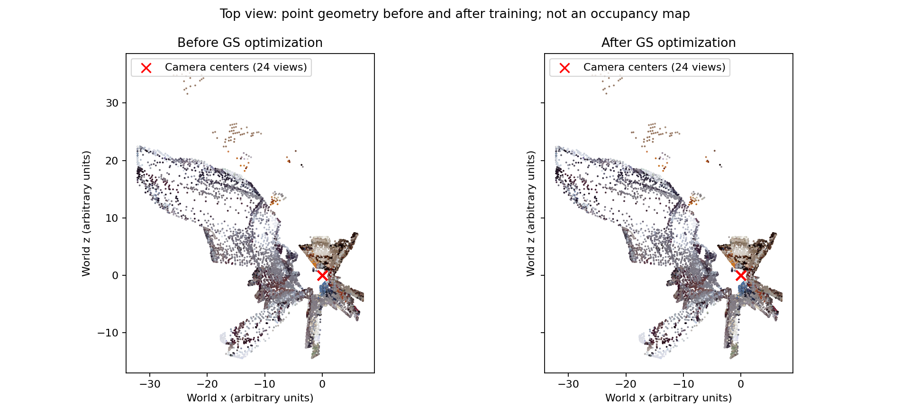
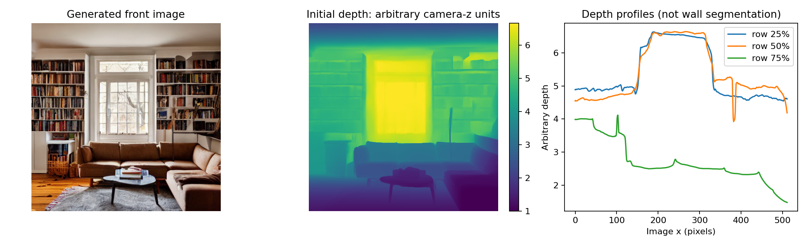

# livingroomの形状歪みの診断 (2026-10-15)

対象: `runs/livingroom`、24方向・512px・1,000ステップ・97,628 Gaussians。学習データと出力の読み取りによる診断であり、生成・学習処理や既存の結果は変更していない。

## 結論

主因は、回転のみの観測では奥行きを決められないことと、相対深度から作ったメッシュを局所的に拡張していること。初期点群の段階ですでに部屋としての大域構造が崩れ、3DGSが学習画像に合わせた外観を持たせている。Unityへの読み込み以前に存在する問題である。

「正面画像だけを多く学習した」という意味での一視点への偏りは確認されなかった。1,000ステップで各画像を41〜42回ずつ使っている。ただし、すべて同じ光学中心からの画像であるため、方向が24種類でも移動による視差は増えていない。

## 確認した事実

|検査|結果|意味|
|---|---|---|
|全カメラの位置|24個とも `[0,0,0]`、最大基線0|その場で見回しているだけ。並進視点の学習なし|
|学習前後の点の移動|中央値0.01788、95%点0.05076、最大0.13525|大きく偏った初期の形状は学習後もほぼそのまま|
|移動量/初期カメラ距離|中央値0.279%、95%点1.381%|少なくとも点中心の大きな位置変形が学習中に新たに生じたとは考えにくい|
|初期点のカメラ距離|中央値5.520、95%点22.307、最大53.990|学習前から広い距離分布と長い外れ値の裾が存在|
|正面の深度範囲|1〜6.667（任意単位）|コードが相対逆深度を人工的な範囲へ写像|
|周回中の保存深度最大|yaw 300度で55.852|局所スケール整合後の範囲が大きく拡大している|
|メッシュの閉鎖性|正面・拡張後とも閉じていない|室内の閉じた構造や閉じた物体形状ではない|
|拡張メッシュの境界辺|17,840本|多数の開いたパッチが存在。境界辺の本数は穴の個数ではない|
|初期点の仰俯角|約 -37.45〜37.12度|真上・真下を覆う観測がない|
|Gaussianの軸長比|中央値1.332、95%点2.871、最大11.402|スケール・回転も学習されるため、細長いスプラットによる局所的な伸びは追加要因になりうる|

距離はメートルではない。方向ごとの深度最大値の違いだけでは、同じ壁の誤差を直接証明したことにならない。また、点中心の移動の小ささはGaussianの大きさ・回転・不透明度の変化を排除しない。Unityのカメラ位置やTransformは取得しておらず、Unity側の追加の変形は未検査。

## 原因の内訳と該当処理

1. **奥行きの幾何的な拘束がない。** `geometry.camera()` は回転行列のみ変更し、translationは常に0。点Pを同じ光線上でs倍しても、同一中心のカメラの投影は `pi(K R^T (sP)) = pi(K R^T P)`。実際に0.5倍・2倍・4倍した点の投影差は検査したカメラで0pxだった。これは点の投影の話であり、Gaussian全体の描画が常に同一だという主張ではない。
2. **各画像の相対深度を独立に加工している。** `Models.depth()` はDepth Anything V2 Smallの相対出力を各画像の2%・98%点で正規化し、`1/(0.15+0.85*normalized)` に変換する。実寸・平面性を保証しない。`align_depth()` は重複部の比の中央値を1回掛けるだけで、逆深度のシフト・局所誤差・全周の整合を同時に直さない。[モデルの公式説明も相対深度モデルとmetric版を区別している](https://github.com/DepthAnything/Depth-Anything-V2/blob/main/README.md)。
3. **初期面がそのまま後続の基準になる。** `fused = where(missing, aligned, reference)` で既存深度を保持し、新規三角形も未観測部分にのみ追加。正面や早い段階の深度誤りを後ろの視点で修正する仕組み、閉ループ最適化はない。補完モデルの入力はRGBと穴マスクで、深度・法線・物体レイアウトの条件入力ではない。
4. **GS学習で形状を直す損失がない。** 学習損失はRGB L1と初期点への位置正則化だけ。保存された `depth_*.npy` は学習で使っていない。壁・床の平面制約や物体形状制約もない。画像上の誤差が小さくても部屋として正しい形になる保証はない。
5. **上下の未観測領域と視点移動。** カメラはyawのみ、画角75度。真上・真下に面を補う処理はない。中心からUnityの視点を移動すると、学習していない視差や遮蔽面が現れるため、歪み・穴が見えやすい。実際のUnity視点の位置は未取得。

## 保存場所と現在のメッシュの意味

```text
\\wsl.localhost\Ubuntu-22.04\home\dpc7\world GS\runs\livingroom\
```

- `front.png`: プロンプトから生成した正面画像。
- `front_depth.npy`: 正面画像から推定・加工した深度。
- `proxy_front.obj`: 正面画像の深度を三角形化した初期メッシュ。16,384頂点・31,212面。
- `proxy_scene.obj`: 360度拡張後のメッシュパッチ集合。393,216頂点・182,202面。未使用頂点も含むため、最終点群数とは異なる。
- `points.npz`: 上記メッシュの参照頂点から作った初期点群。
- `scene_unity.ply`: 学習後のGaussian。メッシュではない。

現在の「メッシュ」は2.5Dの深度面の集合で、ソファ・机・壁などをそれぞれ単純な閉じた形にしたメッシュ群ではない。当初の構想のうち、物体単位の簡略形状による大域構造の確保は未実装である。

## 改善の優先順位

1. 壁・床・天井は平面、家具は箱・粗形状として、部屋全体の共通スケールと構造を先に確保する。正面画像の深度だけに大域形状を任せない。
2. その形状を深度・法線などの条件として新視点画像を生成し、局所スケール合わせから全周での深度・形状整合に進める。
3. 正しいカメラ姿勢に対応した小さな並進視点と上下方向の画像を追加する。並進視点を追加しても、元の誤ったメッシュをそのままレンダリングするだけでは新たな形状の根拠にならない。
4. GSにメッシュ・深度・法線などの正則化を入れ、未使用の移動視点で評価する。学習ステップ数や点数だけを増やすことは、奥行きの不定性の解消にならない。

## 再現

```bash
cd '/home/dpc7/world GS'
~/.venvs/world-gs/bin/python -m worldgs.diagnose runs/livingroom
# matplotlibが使用できる場合は比較図も作成
~/.venvs/world-gs/bin/python -m worldgs.diagnose runs/livingroom --plots
```

ローカルの詳細JSONは `runs/livingroom/diagnostics/geometry_report.json`。初期/学習後の点の対応は、現行の固定点数trainerと保存seedに基づく。




