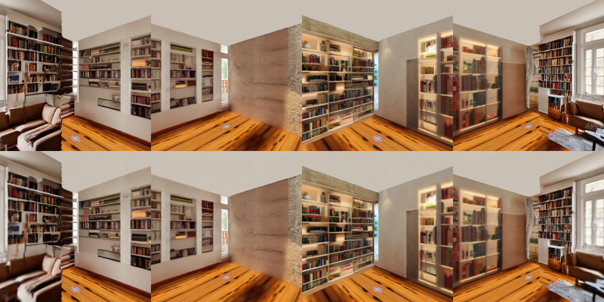

# 形状の安定化: roomモード

最終出力は `runs/livingroom_stable_v2`。旧 `runs/livingroom` と既存の生成結果は保持した。同じ正面画像・prompt・seed 42を使用し、形状と参照データ生成の変更を確認した。比較途中の `livingroom_room_v2`、`livingroom_improved`、`livingroom_refined`、`livingroom_stable` は最終成果物ではない。

## 実装変更

1. **共通の閉じたメッシュ**: 幅6・高さ3・奥行6の部屋を仮定。Grounding DINO Tinyの矩形検出と画像の床接触・相対深度の手がかりから、ソファ1・テーブル1・本棚2を粗い箱にした。寸法は実測値ではない。部屋と家具の個別OBJとラベル・寸法のJSONを出力。
2. **周回中の深度スケールの蓄積を廃止**: 全参照深度は同じメッシュへの解析的なレイ交差で計算。新方向ごとの相対深度正規化と倍率の接続はroomモードでは行わない。正面の相対深度は粗形状推定の補助手がかりとしてのみ使用する。
3. **深度条件付き補完と共有テクスチャ**: ControlNet Depth＋SD1.5 Inpaintingで未取得部分を補完。面ごとのUVアトラスで色を共有し、既知の投影画素を保持する。床には正面画像左下の材質パッチを反復、天井には上部中央の代表色を使用する。これらは未観測面の外観の事前分布。視点別のプロンプト・不要な家具のnegative promptも保存。
4. **並進と上下方向の視点**: 水平12＋上向き6＋下向き6。水平旋回に小さな移動を加え、最大基線0.36。全周の同一形状を参照する。さらに学習から除外した4つの移動カメラを評価用に設けた。
5. **深度損失と形状拘束**: RGB L1＋期待深度のlog L1（重み0.1）＋位置正則化。点を割り当てた箱の面上へ射影し、面内の範囲にも収める。法線方向の厚み0.008、接線方向のスケール上限0.12。軸平行の面なのでGaussianの回転も固定。メッシュに従う制約付きGSであり、自由な3DGSが真の家具形状を復元したという意味ではない。

## 測定結果

|項目|旧livingroom|最終room版|
|---|---:|---:|
|参照画像数|24（水平のみ）|24（水平・上・下）|
|学習カメラの最大基線|0|0.36|
|共有メッシュの頂点・三角形|393,216 / 182,202|40 / 60（部屋＋4家具）|
|共有メッシュの境界辺|17,840|0（各箱は閉じている）|
|初期点の最大カメラ距離|53.990|4.480|
|保存深度の最大|55.852|4.074|
|学習点数|97,628|109,560|
|学習ステップ|1,000|1,000|
|メッシュ面から法線方向への学習後の逸脱|制約なし|0（ハード拘束による）|

距離の単位は任意。新方式は部屋寸法を事前に指定しているので、最大距離の減少は復元精度の改善率ではなく、範囲の暴走を抑えたことを表す。閉じた形状も事前に構築した結果である。学習画像・上下の材質が異なるため、旧新の最終RGB損失をそのまま品質比較しない。

4つの未学習移動視点での**共有メッシュに対する**期待深度の平均相対誤差は、それぞれ1.289%、0.762%、0.723%、1.005%（単純平均0.945%）。評価対象はアトラスで色が利用でき、Gaussianのalphaが0.5を超える画素で、各画像の約97.5〜99.5%。参照は同じメッシュとアトラスから作った画像であり、独立した正解3Dや写真による評価ではない。

対象WSL環境の16件のテストに成功。移動・上下カメラのレイ交差、遮蔽、カメラが家具内に入った場合の検出、アトラス共有、家具の投影位置、床・天井材質を含む。GPUの合成データ20ステップ学習、実データ1,000ステップ学習、未学習カメラ描画、binary little-endian PLYの出力が完了した。`scene.ply` と `scene_unity.ply` のSHA256一致も確認。

## 確認するファイル

```text
\\wsl.localhost\Ubuntu-22.04\home\dpc7\world GS\runs\livingroom_stable_v2\
```

- **scene_unity.ply**: Unity用の最終GS、109,560 Gaussians、約26MiB。
- **meshes/room.obj、meshes/object_00.obj〜object_03.obj**: 部屋・家具の粗い個別メッシュ。家具ラベルはlayout.jsonを参照。
- **proxy_scene.obj**: 上記をまとめた共有メッシュ。
- **proxy_front.obj**: 共通メッシュを正面から見た深度面。
- **layout.json**: 部屋寸法の仮定、検出スコア、家具のラベルと範囲。
- **heldout_preview.png**: 上段は共有メッシュ参照、下段は未学習の移動カメラからのGS描画。
- **train_preview.png、references.jpg、evaluation.json、training.json、diagnostics/**: 描画、参照一覧、評価と形状の数値。

Unityでは新しい `scene_unity.ply` を選び、出力先を `Assets/GaussianAssets/WorldGS_v2` などに変更すれば以前のアセットも保持できる。Import Camerasはオフ。座標はOpenCVのy-downのままなので、必要に応じてGSとメッシュの座標系を揃える。UnityのUIでの取り込み自体は今回操作していない。

## 再現コマンド

```bash
cd '/home/dpc7/world GS'
# 必ず未使用の出力ディレクトリを指定する
./run.sh generate --prompt 'A cozy living room with a sofa, bookshelves and a wooden table, wide angle interior photograph' --output runs/my_new_room --views 12 --seed 42
./run.sh train runs/my_new_room --steps 1000 --max-points 120000
```

比較実験でのみ `--front-image runs/livingroom/front.png` を追加し正面画像を固定した。部屋寸法は `--room-size WIDTH HEIGHT LENGTH` で変更可能。初回にはGrounding DINO TinyとControlNet Depthのモデル取得が加わる。旧方式の再現は `--mode legacy`。

## 残る制約

家具は箱で、L字ソファの実形状、テーブルの脚、物体の背面を復元していない。部屋は単一の直方体で、家具の配置・寸法・物体同士の干渉には誤りが残りうる。未観測の床・天井は材質の仮定、未観測物体面は平坦な色になることがある。壁に生成された本棚などの外観が必ず立体形状を持つわけではない。模様の伸び、継ぎ目、部屋の実寸・画角の推定、真の新視点での評価は引き続き課題。今回対処したのは、相対深度の暴走と形状拘束不足による大きな幾何の破綻である。

実装資料: [Grounding DINO公式API](https://huggingface.co/docs/transformers/model_doc/grounding-dino)、[Diffusers ControlNet API](https://huggingface.co/docs/diffusers/api/pipelines/controlnet)、[ControlNet Depth](https://huggingface.co/lllyasviel/control_v11f1p_sd15_depth)。



最終例: [Unity PLY](improved/scene_unity.ply)、[レイアウト](improved/layout.json)、[学習記録](improved/training.json)、[評価記録](improved/evaluation.json)、[形状診断](improved/geometry_report.json)。
