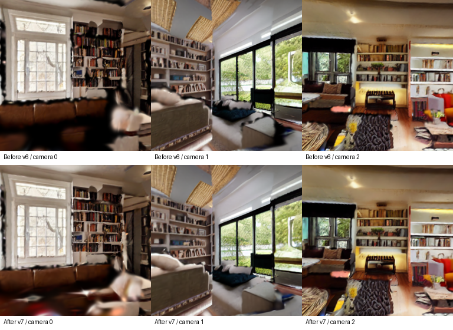
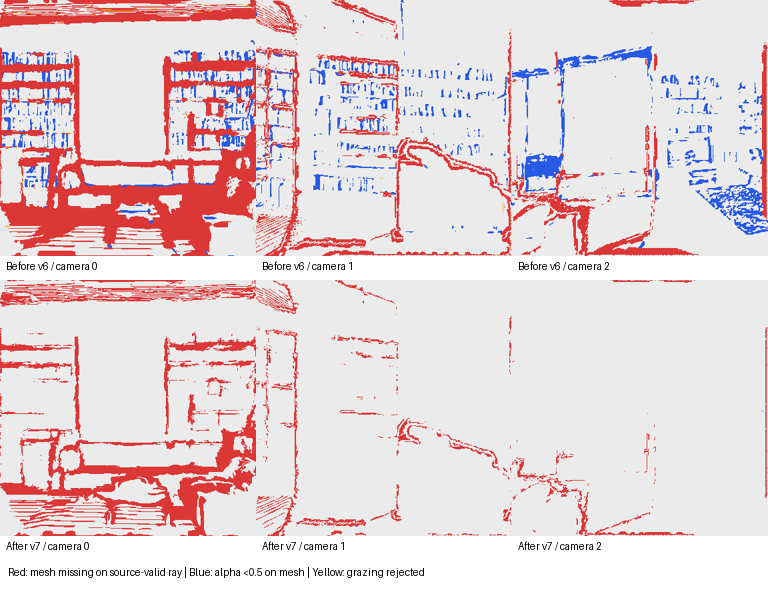

# 穴の原因とv7の対策

## 原因の切り分け

穴には、そもそも面がないものと、面はあるがGSが十分に被覆していないものが混在していた。黒い画素だけで判定すると、暗い材質や影まで穴と誤認するため、メッシュへのレイ交差とGSの累積不透明度alphaを別々に測定した。

v6を元キーフレーム20視点と追加移動3視点の共通カメラで診断した結果：

- 元の推定深度が有効な画素なのに、メッシュの交差がない割合は、入力視点平均で14.15%。
- 面がある画素のうち、GSのalphaが0.5未満は5.375%、0.95未満は44.38%。
- 斜視角の閾値で面を描画対象から除外した割合は全画素の平均0.234%。これは主因ではないが、不要な欠落を増やしていた。

これらは生成画像と推定形状に対する診断であり、実際の部屋の測定精度ではない。

### メッシュ側

深度境界では1画素の収縮と境界帯の膨張除外を行い、境界の両側を落としていた。また、v6では評価実験のため1つの入力視点を融合から外しており、その視点しか支持しない面が製品用出力でも失われていた。TSDFは未知の領域を自動的に閉じる方法ではないため、残った境界を穴として保持していた。

### GS側

RGBと深度のみの損失では、既知の面であってもalphaを1に近づける直接の条件がなかった。低い不透明度と色の組合せでもRGB誤差を小さくできる。加えて、初期点のランダムな間引きや、18万点を超えた場合の不透明度だけによる選別は、領域ごとの被覆を失う経路になっていた。各経路の寄与を個別のアブレーションで確定したものではないが、穴を作り得る選別・損失の構造を修正した。

## 実装した修正

1. 製品用では全入力キーフレームを融合する。1視点を除外する実験は `--holdout-keyframe INDEX` として明示指定に変更。
2. 境界帯を一律に捨てず、近傍の片側で同じ深度が支持される画素を低信頼で保持する。以前の無効画素も、別の2視点から深度が支持される場合だけ回復する。前景と背景の深度を平均してつなぐ処理ではない。
3. 小穴の補修候補を生成し、候補面の中央と3辺の中点を元の深度へ再投影する。全点に支持があり、既知の自由空間へ面を置く矛盾がない三角形だけ採用。大きな未知の穴や、奥が見えている開口を無条件に塞がない。
4. 補修面が辺の三重接続を作らないよう検査し、元の境界と接続しない孤立した補修片を除外する。長い辺は隣接面と中点を共有して分割し、新たな接続割れを防ぐ。
5. メッシュ参照画像の斜視角閾値を0.18から0.02へ緩和。
6. GSに、既知の有効面だけを対象とする `-log(alpha)` の被覆損失を係数0.05で追加。未知画素を不透明にする損失は加えない。信頼度の重みも適用する。
7. 初期点を空間の区画ごとに採り、点数制限時も各区画の代表を先に残す。その後、残り枠を不透明度順で選ぶ。

小穴候補の生成には [Open3D fill_holes](https://www.open3d.org/docs/release/python_api/open3d.t.geometry.TriangleMesh.html) を使用。半径上限は0.18シーン単位。APIが作る候補をそのまま採用せず、元深度と面の接続条件で選別している。単位は仮定したシーン尺度であり、実測メートルではない。

## 実データでの結果

旧入力：`runs/livingroom_fused_mesh_v6_coverage`。新出力：`/home/dpc7/world GS/runs/livingroom_holes_v7_validated`。観測画像・推定深度の元データは同じで、融合と学習の方法を変更した。

|指標|修正前v6|修正後v7|
|---|---:|---:|
|元深度が有効なのに面がない割合|14.15%|8.04%|
|面がある場所でalpha <0.5|5.375%|0.0026%|
|面がある場所でalpha <0.95|44.38%|3.84%|
|両版で共通に見える同じ面でalpha <0.5|5.369%|0.0011%|
|斜視閾値による描画除外（全画素）|0.234%|0.0014%|

面の欠落は元入力20視点、alpha等は同じ23カメラで測った視点ごとの割合の平均。共通面の比較では、両版に面があり深度も合う画素に限定した。alpha 0.5や0.95は診断の閾値で、必ずしも見える穴の境界と一致しない。

小穴の補修候補10,764三角形のうち、深度支持は9,781、接続条件等を満たした採用数は9,651。これは穴の個数ではない。完成メッシュ591,371面、退化面・非多様体の辺0。初期点273,650から60,000点を選んで学習し、2,000ステップ後に180,000 Gaussian、SH3を出力した。学習視点20、評価用の融合メッシュ描画3視点。

製品用では全入力を使っているので、評価用の3描画は独立した正解ではない。alpha診断も推定メッシュ上の被覆評価であり、実世界の形状が正しいことを証明しない。

自動テスト52件に成功。観測で支持される小穴の補修、奥が見える開口の保護、大きな未知の穴の保持、割れのない辺分割、深度境界の保持、斜視面、希少な領域の初期点・低不透明度点の保持、既知面への被覆勾配と未知画素への非適用等を検証した。

## 比較画像

同じ追加移動3カメラでのGS描画。上段v6、下段v7。GSの透けによる黒い穴は減ったが、参照の歪みやぼけが全て直ったわけではない。



前面・90度・180度の原因分類。赤は元深度が有効なのに面がない場所、青は面があるがalphaが0.5未満、黄は斜視面の除外。灰色はその他であり、未観測領域まで正しいと検証した意味ではない。



[検証結果](v7/verification.json)、[修正前の診断](v7/audit-before.json)、[修正後の診断](v7/audit-after.json)、[小穴の補修記録](v7/hole-repair.json)。

## 再実行と保存場所

```bash
cd '/home/dpc7/world GS'
./run.sh rebuild-mesh runs/livingroom_fused_mesh_v6_coverage --output runs/livingroom_holes_new
./run.sh train runs/livingroom_holes_new --steps 2000 --max-points 60000
./run.sh audit-holes runs/livingroom_holes_new --output runs/livingroom_holes_new_audit
```

Unityには新出力の `scene_unity.ply` を取り込む。`scene_mesh.glb` が補修後のメッシュ。元の出力は保持している。

## 残る穴

元深度で支持される面の欠落は約8%残る。大きな未観測領域、深度が矛盾している領域、観測の解像度では開口か欠損か判別できない場所は、局所的な穴埋めだけでは安全に完成できない。今回の修正は全ての穴を閉じたメッシュを生成するものではない。
