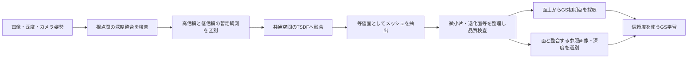
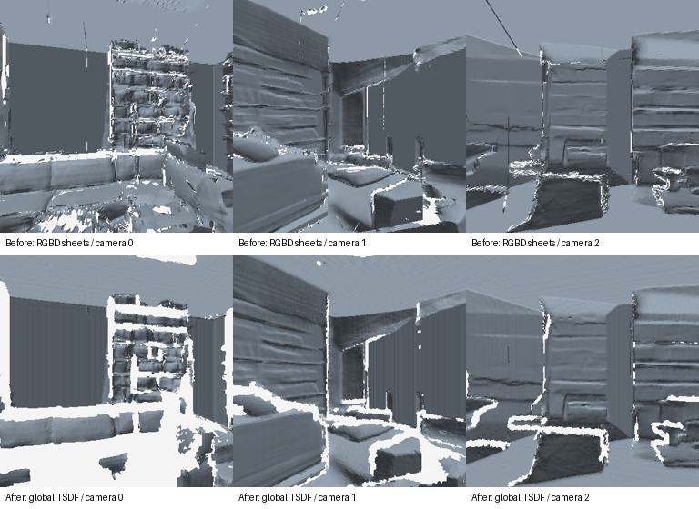
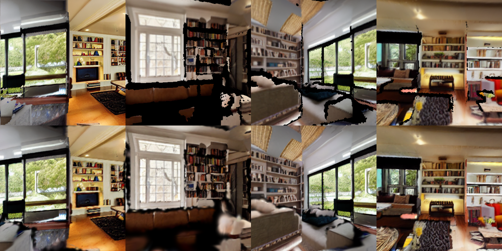

# メッシュの作り方とv6の修正

## これまでの作り方

v4/v5の最終メッシュは物体単位の閉じた3Dモデルではなく、各画像の推定深度を三角形化した板状のパッチ群だった。

1. Depth Anything V2から相対深度を推定し、視点間の重なりで補正する。
2. カメラ内部行列Kと姿勢R,tを使い、各画素を `P_world = R (d K^-1 [u,v,1]) + t` で3D点へ変換する。
3. 2画素おきの格子を作り、隣接4点を2枚の三角形で結ぶ。頂点間の深度差が最小深度の10%を超える面を除外する。
4. 新しいパッチから既観測と矛盾する面を削り、残ったパッチを単純に結合する。
5. GS初期点は、最終メッシュの面とは別に、各キーフレームの深度から作っていた。

この方式には、画像の格子に依存した面、パッチ間で共有されない頂点、多重の面や小片、面の削除後の穴が残る。深度の10%という条件だけでは、画素間隔に対して長すぎる辺も通過する。また、棄却された面に対応する点をGSへ混入させる可能性があった。境界の深度補正だけでは、この構造上の問題は解決しなかった。

## 修正方針と実装



### 視点間の支持

追加で描画した参照画像は融合の観測数へ入れず、元の補完キーフレームだけを使う。同一位置の回転や同じ画像の反復を、多視点の幾何的支持とは数えない。カメラ位置が0.06シーン単位以上異なる観測との一致を調べる。

高信頼の面は、既定で2視点以上の深度支持があり、自由空間との矛盾が少ないもの。幾何の支持判定から強いRGB一致条件を外し、本棚の模様が再投影でずれるだけで面を失わないようにした。

比較できない滑らかな単視点面は、他視点の自由空間と矛盾しない場合のみ暫定的に残す。暫定面は正しいと確定した面ではない。全てを削る厳格な方式も試したが、床・家具の欠落が増えたため既定は信頼度を分けて保持する方式とした。

### 全体の融合

Open3DのTSDFへ観測を統合し、Marching Cubesで共通の表面を取り出す。既定のボクセル幅は0.025、打ち切り距離はその3倍。尺度は仮定したシーン単位であり、実測メートルではない。

高信頼観測と暫定観測の融合重みは4:1。Legacy TSDF APIでは高信頼画素だけの統合を追加して、この比率を実装した。追加の統合は観測数が増えたことを意味しない。

微小な頂点間隔をボクセル幅の12%以内で統合し、小さな連結成分、退化面、非多様体の辺を整理する。Taubin平滑化を3回適用するが、頂点移動はボクセル幅の半分までに制限する。未知の穴を無条件に閉じたり、家具を箱へ置き換えたりはしない。

[Open3D RGB-D融合](https://www.open3d.org/docs/release/tutorial/pipelines/rgbd_integration.html)、[メッシュ処理](https://www.open3d.org/docs/release/tutorial/geometry/mesh.html)を使用。本環境の既存Open3D 0.20.0では既知の平面が空の抽出結果になったため、専用仮想環境へ0.19.0を導入し、平面復元テストを追加した。他プロジェクトの環境は変更していない。

### GSへの受け渡し

GS初期点は最終メッシュの面を面積に応じてサンプリングする。面IDと重心座標を保存し、書き出したGLBの面との一致も検査する。過去の各深度画像から棄却点を再導入しない。

RGB教師は元のキーフレームを使い、最終メッシュの描画深度と合う画素を選ぶ。高信頼画素1.0、暫定画素0.25でRGB・深度損失へ重みを付ける。重みの合計で再正規化せず画素数で割り、暫定画素だけの視点も影響が4分の1になるようにする。

有限頂点、100面以上、退化面0、非多様体の辺0、最大辺長4ボクセル以下、初期点と指定面の誤差1e-4以下を検査し、不合格ならGS学習を止める。これは幾何データの検査であり、物体の正確さや穴のなさを保証しない。GSの位置拘束は引き続き0で、位置・回転・大きさ等を学習する。

## 今回の実行結果

入力：`runs/livingroom_depth_seams_v5_final`。新しい画像や深度の生成ではなく、既存の補正済み観測を使って融合方法とGS初期化を変更した。

最終出力：`/home/dpc7/world GS/runs/livingroom_fused_mesh_v6_coverage`。

|項目|旧v5|新v6（暫定面を保持）|
|---|---:|---:|
|三角形数|726,232|517,958|
|連結成分数|1,173|82|
|50面未満の小片|984|1|
|退化面|0|0|
|非多様体の辺|0|0|
|最大辺長（シーン単位）|0.513|0.0468|
|三角形の細長さ指標・95%点|6.93|5.09|
|境界辺数|53,728|45,846|
|境界辺の割合|4.81%|5.73%|

分断は減ったが、境界辺の割合は増えており、穴が閉じたとは言えない。微小片も1個残る。旧版と新版では面の残し方が異なるため、三角形数や表面積の減少自体を精度向上とは扱わない。

初期点270,724、学習19視点・評価4視点、2,000ステップ、60,000点開始・180,000 Gaussian終了、SH3。書き出したGLBと初期点の最大誤差は約5.94e-7シーン単位。学習に残った画素の約31.4%は暫定の低信頼画素。

1つの元キーフレームを支持判定・TSDF融合・GS学習から除外し、残りの評価視点と区別した。ただし元画像自体が過去の再投影を含む生成画像なので、独立した実写の正解ではない。

自動テスト43件が成功。平面の復元、カメラ変換、同一位置の反復を支持に数えないこと、矛盾点の除外、暫定点の重み、微小片の除去、面上の初期点、学習前の不合格停止、暫定画素の損失と勾配等を検証。

### 色を外したメッシュ比較

上段がv5の深度パッチ、下段がv6。灰色の陰影は形状の確認用で、Unityの照明対応を示すものではない。白い部分は欠落。段差・ざらつきは減ったが、元の誤深度に由来する形の歪みと欠落は残る。



### GS出力

上段が評価用の参照、下段がGS。最初の列は融合から除外した元キーフレーム、残りは融合メッシュの描画。



[検証結果](v6/verification.json)、[面の品質](v6/mesh-quality.json)、[視点支持](v6/support-report.json)。

## 再実行

```bash
cd '/home/dpc7/world GS'
bash setup.sh
./run.sh rebuild-mesh runs/livingroom_depth_seams_v5_final --output runs/livingroom_fused_new --voxel-size .025 --min-views 2
./run.sh train runs/livingroom_fused_new --steps 2000 --max-points 60000
```

`generate --mode expand` と `refine-depth` も最後に同じ融合処理を行う。新規生成・深度修正の場合、中間観測は出力内の `observations/` に置く。最終メッシュは出力直下の `scene_mesh.glb`。比較のため暫定面を除外したい場合だけ `rebuild-mesh` に `--strict-support` を付ける。細部を残すためにボクセル幅を小さくすると、ノイズ・面数・処理量も増える。

## 未解決の問題

今回直したのは、パッチの単純追加、微小片、GS初期点との不整合などの構造上の問題。入力にある誤深度、全周で一致しない家具、閉じていない物体の背面を全て復元したわけではない。TSDFが返すのは観測に基づく表面であり、完成した物体モデルの群ではない。大きな移動時の穴・形状の歪み・細部の欠落は残り、写実的シーンの完成版とは扱えない。
